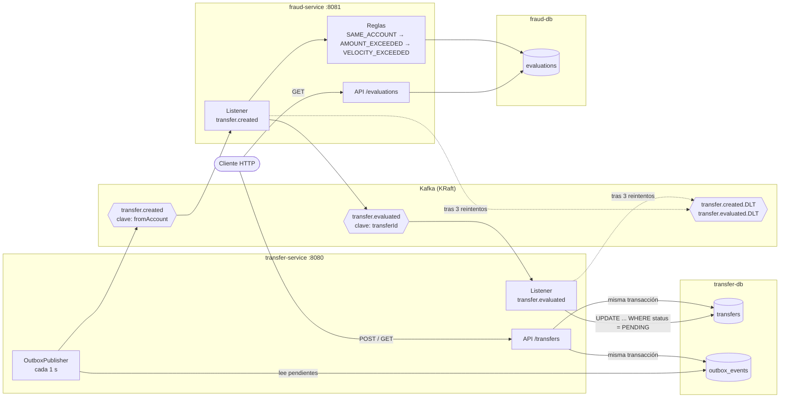

# Transferencias con evaluación de fraude asíncrona

Dos microservicios Spring Boot que se comunican solo por Kafka:

- **transfer-service** recibe las transferencias por HTTP y las guarda como `PENDING`.
- **fraud-service** evalúa el riesgo de cada una sin bloquear la API.

Con la decisión de fraud-service, transfer-service cambia la transferencia a `COMPLETED` o `REJECTED`.

Es un proyecto de portafolio y aprendizaje de arquitectura orientada a eventos. Usa el patrón outbox, entrega al menos una vez con consumidores idempotentes, reintentos con DLT y un `correlationId` de punta a punta.

**Stack:**
- Java 21 y Spring Boot 4.1 con Spring for Apache Kafka
- PostgreSQL 18, con una base por servicio y migraciones Flyway
- Kafka 4.4 en modo KRaft
- Testcontainers para las pruebas de integración

## Arquitectura



El flujo paso a paso:

1. `POST /transfers` valida los datos. En una misma transacción guarda la transferencia en `PENDING` y una fila en `outbox_events`, y responde `202`.
2. Un publicador programado lee el outbox y publica `transfer.created` con clave `fromAccount`.
3. fraud-service aplica las reglas en orden, guarda la evaluación y publica `transfer.evaluated` con la decisión.
4. transfer-service consume la decisión y actualiza la transferencia a `COMPLETED` o `REJECTED`.

La guía [docs/como-funciona.md](docs/como-funciona.md) tiene el diagrama de secuencia, los estados y el orden recomendado para leer el código.

### Reglas de fraude

Se evalúan en este orden y se guarda el **primer** motivo que aplique:

| Orden | Regla | Motivo |
|---|---|---|
| 1 | La cuenta origen es igual a la destino | `SAME_ACCOUNT` |
| 2 | El monto es mayor que el umbral (10.000.000 COP por defecto) | `AMOUNT_EXCEEDED` |
| 3 | Ya hay 3 transferencias del mismo origen en los 60 s anteriores (se rechaza la cuarta) | `VELOCITY_EXCEEDED` |
| — | Ninguna aplica | `APPROVED`, motivo `null` |

La regla de velocidad cuenta todos los intentos evaluados, también los rechazados. La ventana es `[createdAt − 60 s, createdAt)` y usa la hora de creación del evento, no la de procesamiento.

## Levantar todo

Requisitos: Docker con Compose v2. Para compilar o ejecutar las pruebas fuera de Docker también necesitas un JDK 21 o superior; Maven no hace falta, porque el proyecto trae el Maven Wrapper.

1. Opcional: copia el archivo de configuración. Todas las variables tienen un valor por defecto.

   ```bash
   cp .env.example .env
   ```

   Si el puerto 5432 ya está ocupado en tu máquina (por ejemplo, por un PostgreSQL local), cambia `TRANSFER_DB_HOST_PORT` en `.env`, por ejemplo a `5434`.

2. Levanta todo con Kafka UI:

   ```bash
   docker compose --profile ui up --build
   ```

   Sin Kafka UI:

   ```bash
   docker compose up --build
   ```

Compose espera a que cada contenedor esté sano antes de arrancar los que dependen de él.

| Componente | URL / puerto en el host |
|---|---|
| transfer-service | <http://localhost:8080> ([Swagger UI](http://localhost:8080/swagger-ui.html), [health](http://localhost:8080/actuator/health)) |
| fraud-service | <http://localhost:8081> ([Swagger UI](http://localhost:8081/swagger-ui.html), [health](http://localhost:8081/actuator/health)) |
| Kafka UI (perfil `ui`) | <http://localhost:8090> |
| Kafka (desde el host) | `localhost:9092` |
| transfer-db / fraud-db | `localhost:5432` / `localhost:5433` |

Para apagar todo y borrar los datos:

```bash
docker compose --profile ui down -v
```

## Probar los endpoints

### Crear una transferencia

```bash
curl -i -X POST localhost:8080/transfers -H 'Content-Type: application/json' -H 'X-Correlation-Id: demo-123' -d '{"fromAccount":"ACC-001","toAccount":"ACC-002","amount":150000.00,"currency":"COP"}'
```

```text
HTTP/1.1 202
X-Correlation-Id: demo-123

{"id":"513b8ac5-16d8-4275-b9bb-6e0453fd06f7","status":"PENDING"}
```

El header `X-Correlation-Id` es opcional. Si no lo envías, se genera uno y se devuelve en la respuesta.

### Consultar la transferencia

Reemplaza `<id>` por el `id` de la respuesta anterior. Uno o dos segundos después ya tiene su estado final:

```bash
curl localhost:8080/transfers/<id>
```

```json
{"id":"513b8ac5-16d8-4275-b9bb-6e0453fd06f7","fromAccount":"ACC-001","toAccount":"ACC-002","amount":150000.00,"currency":"COP","status":"COMPLETED","reason":null,"createdAt":"2026-11-19T22:13:34.481882Z","updatedAt":"2026-11-19T22:13:36.243421Z"}
```

### Listar las transferencias de una cuenta

`fromAccount` es obligatorio. `page` empieza en 0 y `size` va de 1 a 100 (20 por defecto). Las transferencias se ordenan de la más reciente a la más antigua.

```bash
curl 'localhost:8080/transfers?fromAccount=ACC-001&page=0&size=20'
```

```json
{"content":[{"id":"513b8ac5-16d8-4275-b9bb-6e0453fd06f7","fromAccount":"ACC-001","toAccount":"ACC-002","amount":150000.00,"currency":"COP","status":"COMPLETED","reason":null,"createdAt":"2026-11-19T22:13:34.481882Z","updatedAt":"2026-11-19T22:13:36.243421Z"}],"page":0,"size":20,"totalElements":1,"totalPages":1}
```

### Consultar la evaluación de fraude

```bash
curl localhost:8081/evaluations/<id>
```

```json
{"id":"56b4cf41-5c65-4e9b-acc7-803abbf7c285","transferId":"513b8ac5-16d8-4275-b9bb-6e0453fd06f7","fromAccount":"ACC-001","amount":150000.00,"decision":"APPROVED","reason":null,"transferCreatedAt":"2026-11-19T22:13:34.481882Z","evaluatedAt":"2026-11-19T22:13:36.095040Z"}
```

### Errores

Los errores siguen el formato `ProblemDetail` (RFC 9457).

Un 400 de validación incluye el detalle de cada campo:

```bash
curl -X POST localhost:8080/transfers -H 'Content-Type: application/json' -d '{"fromAccount":"ACC-001","toAccount":"ACC-002","amount":10.123,"currency":"USD"}'
```

```json
{"detail":"La solicitud tiene campos inválidos","instance":"/transfers","status":400,"title":"Bad Request","errors":{"amount":"numeric value out of bounds (<17 digits>.<2 digits> expected)","currency":"solo se acepta COP"}}
```

Un id que no existe responde 404. Pasa lo mismo con `GET /evaluations/{transferId}`:

```bash
curl localhost:8080/transfers/00000000-0000-0000-0000-000000000000
```

```json
{"detail":"No existe la transferencia 00000000-0000-0000-0000-000000000000","instance":"/transfers/00000000-0000-0000-0000-000000000000","status":404,"title":"Transfer not found"}
```

## Probar cada regla de fraude

Cada ejemplo crea la transferencia, espera 3 segundos y consulta su estado final. Usa una cuenta distinta en cada uno para que no se crucen con la regla de velocidad.

**Aprobada** (`COMPLETED`, sin motivo):

```bash
ID=$(curl -s -X POST localhost:8080/transfers -H 'Content-Type: application/json' -d '{"fromAccount":"ACC-100","toAccount":"ACC-200","amount":150000.00,"currency":"COP"}' | sed -E 's/.*"id":"([^"]+)".*/\1/'); sleep 3; curl -s localhost:8080/transfers/$ID; echo
```

**`SAME_ACCOUNT`:** la cuenta origen es igual a la destino. La API la acepta con `202` y es fraud-service quien la rechaza.

```bash
ID=$(curl -s -X POST localhost:8080/transfers -H 'Content-Type: application/json' -d '{"fromAccount":"ACC-300","toAccount":"ACC-300","amount":50.00,"currency":"COP"}' | sed -E 's/.*"id":"([^"]+)".*/\1/'); sleep 3; curl -s localhost:8080/transfers/$ID; echo
```

**`AMOUNT_EXCEEDED`:** el monto es mayor que 10.000.000. Un monto exactamente igual al umbral se aprueba.

```bash
ID=$(curl -s -X POST localhost:8080/transfers -H 'Content-Type: application/json' -d '{"fromAccount":"ACC-400","toAccount":"ACC-200","amount":20000000.00,"currency":"COP"}' | sed -E 's/.*"id":"([^"]+)".*/\1/'); sleep 3; curl -s localhost:8080/transfers/$ID; echo
```

**`VELOCITY_EXCEEDED`:** cuatro transferencias seguidas desde la misma cuenta. Las tres primeras se aprueban y la cuarta se rechaza:

```bash
for i in 1 2 3 4; do curl -s -X POST localhost:8080/transfers -H 'Content-Type: application/json' -d '{"fromAccount":"ACC-500","toAccount":"ACC-200","amount":1000.00,"currency":"COP"}'; echo; done; sleep 3; curl -s 'localhost:8080/transfers?fromAccount=ACC-500'; echo
```

La lista sale de la más reciente a la más antigua, así que la primera transferencia es la rechazada. Después de 60 segundos, la misma cuenta vuelve a poder transferir.

### Cambiar los umbrales

Las reglas se configuran con `fraud.rules.*` en [application.yml](fraud-service/src/main/resources/application.yml) y se pueden sobrescribir con variables de entorno, en `.env` o en la línea de comandos. Por ejemplo, para bajar el umbral de monto a 500 COP:

```bash
FRAUD_RULES_AMOUNT_THRESHOLD=500 docker compose up -d fraud-service
```

| Variable | Valor por defecto |
|---|---|
| `FRAUD_RULES_AMOUNT_THRESHOLD` | `10000000` |
| `FRAUD_RULES_VELOCITY_MAX_TRANSFERS` | `3` |
| `FRAUD_RULES_VELOCITY_WINDOW` | `60s` |

## Ver los mensajes en Kafka

### Con Kafka UI

1. Levanta el stack con `--profile ui` y abre <http://localhost:8090>.
2. Entra a **Topics**. Verás `transfer.created`, `transfer.evaluated` y sus DLT: `transfer.created.DLT` y `transfer.evaluated.DLT`.
3. Abre un topic y luego la pestaña **Messages**. En cada mensaje puedes ver:
   - la **clave**: `fromAccount` en `transfer.created` y `transferId` en `transfer.evaluated`;
   - el **valor**: el JSON del evento;
   - los **headers**: `correlationId`.
4. Los mensajes que fallaron, tras 3 reintentos o por JSON inválido, aparecen en las DLT. Los headers `kafka_dlt-*` dicen por qué fallaron.

### Desde la terminal

```bash
docker compose exec kafka /opt/kafka/bin/kafka-console-consumer.sh --bootstrap-server kafka:29092 --topic transfer.evaluated --from-beginning --formatter-property print.key=true --formatter-property print.headers=true
```

```text
correlationId:demo-123	513b8ac5-16d8-4275-b9bb-6e0453fd06f7	{"eventId":"56b4cf41-5c65-4e9b-acc7-803abbf7c285","transferId":"513b8ac5-16d8-4275-b9bb-6e0453fd06f7","decision":"APPROVED","reason":null,"evaluatedAt":"2026-11-19T22:13:36.095040Z"}
```

### Seguir una petición en los logs

En Docker los logs salen en JSON, en formato ECS, e incluyen el `correlationId`. Con este comando ves la misma petición en los dos servicios:

```bash
docker compose logs transfer-service fraud-service | grep demo-123
```

## Ejecutar las pruebas

Las pruebas de integración levantan Kafka y PostgreSQL con Testcontainers, así que Docker tiene que estar corriendo.

```bash
./mvnw verify
```

Para ejecutar las pruebas de un solo servicio:

```bash
./mvnw -pl fraud-service verify
```

Qué cubren:

- **Unitarias (JUnit 5 + Mockito):** cada regla de fraude, `EvaluationService` (incluidas la idempotencia y la carrera por la restricción única), `EvaluationPublisher`, `TransferService` y `OutboxPublisher`.
- **Integración:** el flujo de cada servicio con Kafka y PostgreSQL reales. Incluye:
  - el outbox y el `correlationId`;
  - cada regla, con la ventana de velocidad calculada con la hora del evento;
  - los duplicados;
  - la DLT por JSON inválido (sin reintentos) y por fallo de procesamiento (tras 1 s, 2 s y 4 s);
  - las validaciones de la API.

## Ejecutar un servicio desde el IDE

Con el perfil `local` (el que se usa por defecto), un servicio corre en el IDE contra la infraestructura de Compose.

1. Levanta solo la infraestructura:

   ```bash
   docker compose up -d kafka transfer-db fraud-db
   ```

2. Ejecuta el servicio:

   ```bash
   ./mvnw -pl transfer-service spring-boot:run
   ```

Si cambiaste los puertos del host en `.env`, exporta también las URLs de conexión. Por ejemplo, `TRANSFER_DB_URL=jdbc:postgresql://localhost:5434/transfers`. Las tienes comentadas en [.env.example](.env.example).

## Decisiones de diseño

- **Outbox en transfer-service.** La transferencia y su evento se guardan en la misma transacción, así que una caída nunca deja una transferencia sin evento ni un evento sin transferencia. Un publicador `@Scheduled` envía los pendientes en orden, espera la confirmación de Kafka y los marca como publicados. Si un envío falla, corta el lote para no adelantar eventos posteriores. No se usa Debezium.
- **fraud-service no necesita outbox.** Si falla al publicar la decisión, el mensaje de entrada se reintenta y, gracias a la idempotencia, reenvía la decisión ya guardada.
- **`fromAccount` como clave de `transfer.created`.** Todas las transferencias de una cuenta caen en la misma partición y se procesan en orden, así que la regla de velocidad cuenta bien.
- **Al menos una vez y consumidores idempotentes:**
  - fraud-service no reevalúa un `transferId` ya visto. La restricción única cubre las condiciones de carrera.
  - transfer-service solo actualiza con `UPDATE ... WHERE status = 'PENDING'`.
  - En los productores, `acks=all` y la idempotencia activada.
  - En los consumidores, commit manual por registro.
- **Reintentos y DLT.** Cada fallo se reintenta 3 veces (1 s, 2 s y 4 s) y luego el mensaje va a `<topic>.DLT`, en la misma partición. No se reintentan, porque fallarían igual:
  - el JSON inválido;
  - los eventos sin datos obligatorios.
- **El contrato es el JSON.** No hay librería compartida: cada servicio define sus propios `record` de eventos, y los type headers de Kafka están desactivados.
- **Una clase por regla** detrás de la interfaz `FraudRule`, ordenadas con `@Order`. Así se prueban por separado y se agregan reglas nuevas sin tocar las demás.
- **Spring MVC y no WebFlux.** JPA, JDBC y el listener de Kafka son bloqueantes, así que un stack reactivo no aportaría nada.

El detalle completo, con versiones, supuestos y hallazgos, está en [specs/001-transfer-fraud/plan.md](specs/001-transfer-fraud/plan.md).

## Limitaciones conocidas

- **Una transferencia cuyo evento llega a una DLT queda en `PENDING` para siempre.** No hay reconciliación ni una herramienta para reprocesar las DLT. Hay que revisarlas y volver a publicar los mensajes a mano.
- **Si la propia DLT no está disponible**, por ejemplo con Kafka caído, el mensaje se reintenta indefinidamente. No se pierde, pero bloquea su partición mientras tanto.
- **Kafka tiene un solo nodo** y los topics tienen una sola réplica. Sirve para local, no para producción.
- **Solo se acepta la moneda `COP`**, y no hay autenticación ni autorización.
- **Las filas ya publicadas del outbox no se borran**, porque no hay un proceso de limpieza.
- **La regla de velocidad confía en el `createdAt` del evento.** Es correcto porque lo asigna transfer-service, pero un productor externo con relojes desfasados podría esquivarla.

## Estructura

```text
├── pom.xml                  # Agregador Maven (Spring Boot 4.1.2)
├── docker-compose.yml       # Kafka, Kafka UI, dos PostgreSQL y los dos servicios
├── .env.example             # Todas las variables configurables
├── SPEC.md                  # Especificación
├── docs/                    # Constitución y guía con diagramas
├── specs/001-transfer-fraud # Plan técnico y tareas por fase
├── transfer-service/        # api, service, domain, repository, messaging, config
└── fraud-service/           # Lo mismo, más rules
```
