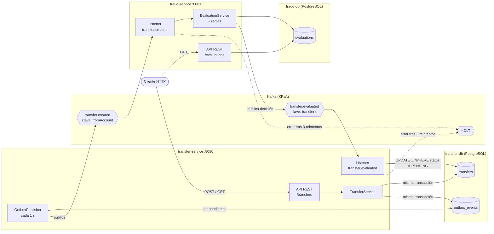
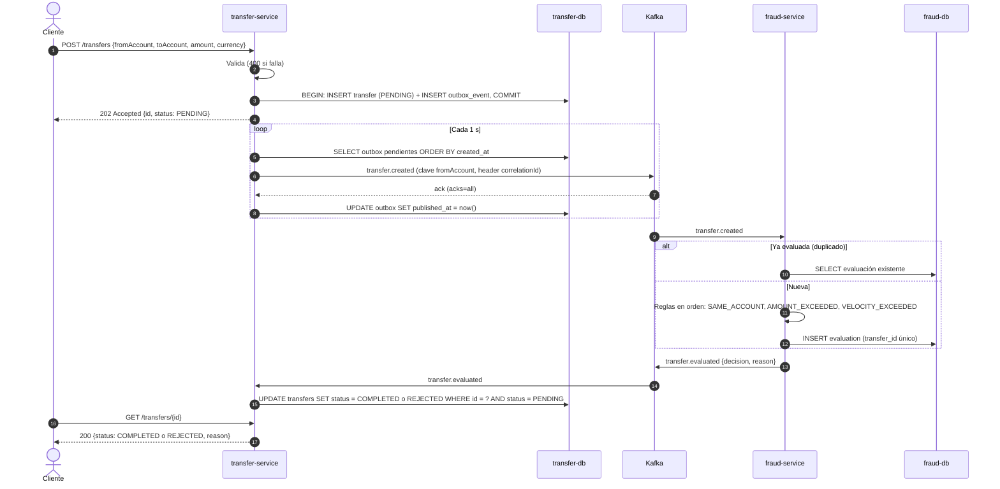
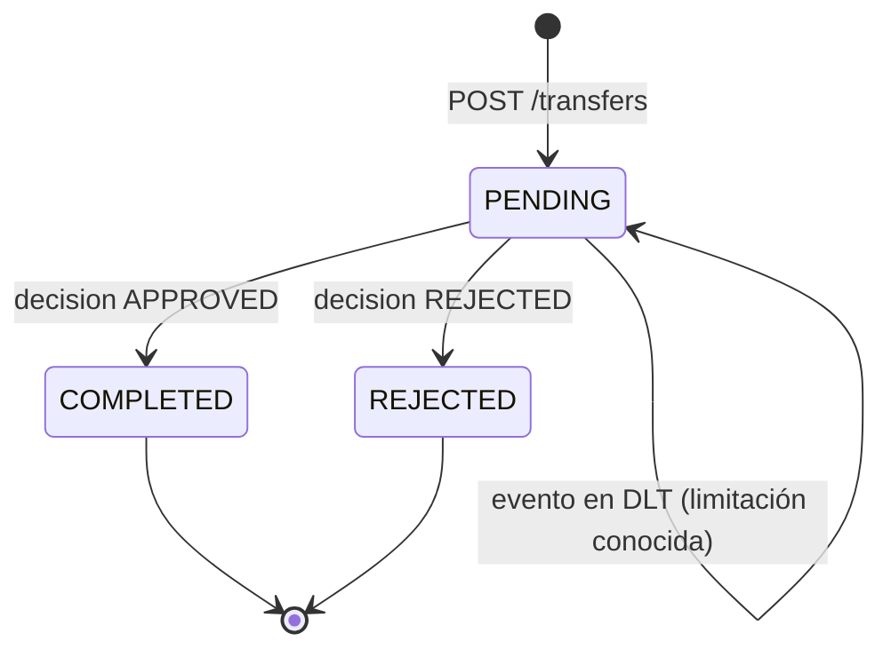

# Cómo funciona el proyecto

Guía para entender el sistema: primero el flujo con diagramas y después qué archivos leer y en qué orden.

> **Estado actual:** las fases (a) y (b) están terminadas (infraestructura y transfer-service). Los archivos marcados con 🔜 se crean en las fases (c) y (d).

## 1. Vista general



**Idea clave:** los dos servicios nunca se llaman entre sí. Solo se comunican por Kafka, y cada uno tiene su propia base de datos.

## 2. El flujo paso a paso



### ¿Por qué cada pieza?

| Pieza | Problema que resuelve |
|---|---|
| **Outbox** | Si se guardara en la base y se publicara a Kafka por separado, una caída entre los dos pasos dejaría una transferencia sin evento, o un evento sin transferencia. El outbox hace que ambas cosas se guarden juntas o ninguna. |
| **Clave `fromAccount`** | Todas las transferencias de una cuenta caen en la misma partición y se procesan en orden, así que la regla de velocidad cuenta bien. |
| **Idempotencia** | Kafka garantiza "al menos una vez", así que pueden llegar duplicados. fraud-service no reevalúa un `transferId` ya visto, y transfer-service solo actualiza si la transferencia sigue en `PENDING`. |
| **DLT** | Un mensaje que falla siempre no debe bloquear la partición. Tras 3 reintentos se aparta en `<topic>.DLT`. |
| **`correlationId`** | Permite seguir una misma petición en los logs de los dos servicios. |

### Estados de una transferencia



## 3. Qué archivos revisar y en qué orden

### Paso 1: El qué y el porqué (documentos)

1. [SPEC.md](../SPEC.md): qué hace el sistema, las reglas de fraude, los eventos y las decisiones aprobadas.
2. [docs/constitution.md](constitution.md): las reglas de juego del desarrollo.
3. [specs/001-transfer-fraud/plan.md](../specs/001-transfer-fraud/plan.md): cómo se implementa, con las versiones y las decisiones técnicas.
4. [specs/001-transfer-fraud/tasks.md](../specs/001-transfer-fraud/tasks.md): qué está hecho y qué falta.

### Paso 2: Infraestructura (fase a, ya existe)

5. [docker-compose.yml](../docker-compose.yml): todos los contenedores, sus health checks y los listeners de Kafka.
6. [.env.example](../.env.example): todas las variables configurables.
7. [pom.xml](../pom.xml): el agregador Maven y la versión de Spring Boot.
8. [transfer-service/pom.xml](../transfer-service/pom.xml): las dependencias de cada servicio (fraud-service usa las mismas).
9. [transfer-service/Dockerfile](../transfer-service/Dockerfile): el build multi-stage y el usuario no root.
10. [transfer-service/src/main/resources/application.yml](../transfer-service/src/main/resources/application.yml) y los perfiles `application-local.yml` / `application-docker.yml`.
11. [fraud-service/src/main/resources/application.yml](../fraud-service/src/main/resources/application.yml): incluye `fraud.rules.*`.

### Paso 3: transfer-service (fase b, ya existe)

Se lee siguiendo el camino de una petición. Las rutas son relativas a `transfer-service/src/main/`:

12. [V1__create_transfers_and_outbox.sql](../transfer-service/src/main/resources/db/migration/V1__create_transfers_and_outbox.sql): las tablas `transfers` y `outbox_events`.
13. [domain/](../transfer-service/src/main/java/com/example/transfer/domain): `Transfer`, `TransferStatus`, `OutboxEvent`.
14. [api/TransferController.java](../transfer-service/src/main/java/com/example/transfer/api/TransferController.java), luego `CreateTransferRequest` (las validaciones) y [GlobalExceptionHandler.java](../transfer-service/src/main/java/com/example/transfer/api/GlobalExceptionHandler.java).
15. [service/TransferService.java](../transfer-service/src/main/java/com/example/transfer/service/TransferService.java): **el punto clave**, donde la transferencia y el outbox se guardan en la misma transacción, y donde se aplica la decisión.
16. [messaging/OutboxPublisher.java](../transfer-service/src/main/java/com/example/transfer/messaging/OutboxPublisher.java): cómo el outbox llega a Kafka.
17. [resources/application.yml](../transfer-service/src/main/resources/application.yml): productor, consumidor y outbox; luego [config/KafkaTopics.java](../transfer-service/src/main/java/com/example/transfer/config/KafkaTopics.java), [config/KafkaErrorHandlingConfig.java](../transfer-service/src/main/java/com/example/transfer/config/KafkaErrorHandlingConfig.java) (reintentos y DLT) y [config/CorrelationIdFilter.java](../transfer-service/src/main/java/com/example/transfer/config/CorrelationIdFilter.java).
18. [messaging/TransferEvaluatedListener.java](../transfer-service/src/main/java/com/example/transfer/messaging/TransferEvaluatedListener.java) y [repository/TransferRepository.java](../transfer-service/src/main/java/com/example/transfer/repository/TransferRepository.java): cómo vuelve la decisión y se aplica de forma idempotente.
19. [TransferServiceIntegrationTest.java](../transfer-service/src/test/java/com/example/transfer/integration/TransferServiceIntegrationTest.java): todo lo anterior funcionando con Kafka y PostgreSQL reales.

### Paso 4: fraud-service (fase c) 🔜

20. `db/migration/V1__...sql`: la tabla `evaluations`, su restricción única y su índice.
21. `rules/FraudRule` y luego una clase por regla: **el corazón del negocio**.
22. `service/EvaluationService`: el orden de las reglas y la idempotencia.
23. `messaging/TransferCreatedListener` → publicación de `transfer.evaluated`.
24. `api/EvaluationController`.

### Paso 5: Pruebas y README (fase d) 🔜

25. `src/test/.../unit/`: cada regla y cada servicio por separado.
26. `src/test/.../integration/`: el flujo real con Kafka y PostgreSQL en Testcontainers.
27. `README.md`: ejemplos `curl` para ejecutar el flujo tú mismo.

## 4. Probarlo tú mismo (fase a)

```bash
cp .env.example .env
```

Si el puerto 5432 está ocupado en tu máquina, cambia `TRANSFER_DB_HOST_PORT=5434` en `.env`.

```bash
docker compose --profile ui up --build
```

- Health de transfer-service: <http://localhost:8080/actuator/health>
- Health de fraud-service: <http://localhost:8081/actuator/health>
- Kafka UI: <http://localhost:8090>
